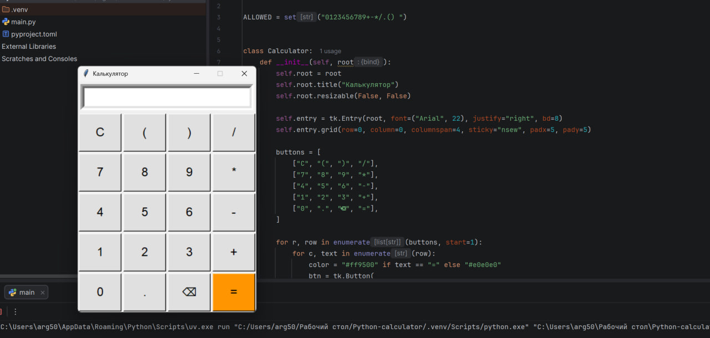

# Calculator (Tkinter)

A desktop calculator written in Python with `tkinter`.



- Buttons for digits, `+ - * /`, brackets and decimal point
- `C` clears the input, `⌫` deletes the last character
- `Enter` calculates, `Esc` clears
- Only digits and arithmetic characters are allowed in the expression before it is evaluated

## Run

```
python main.py
```

Requires Python 3.14+ (standard library only, no extra packages).
